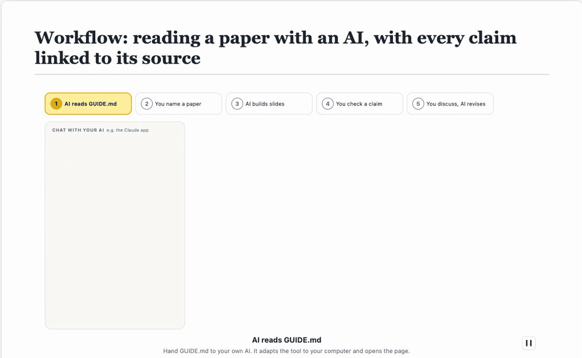
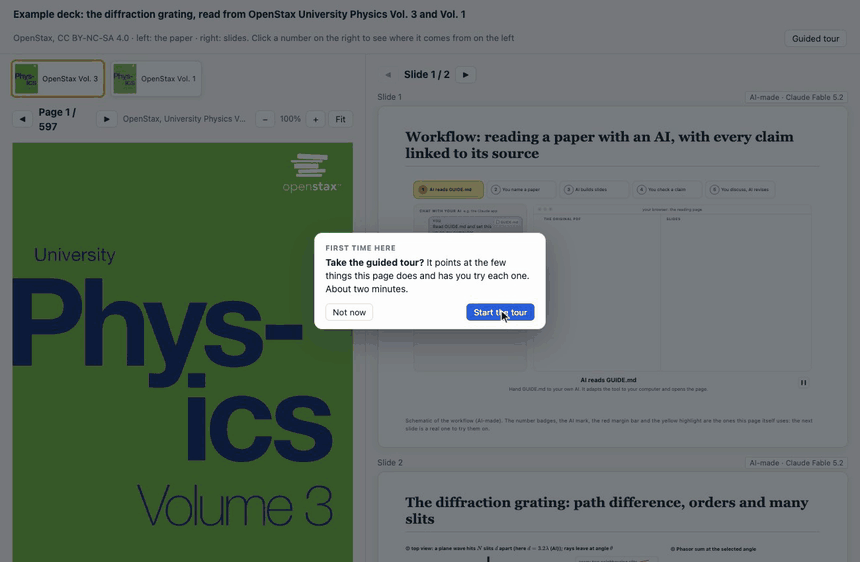
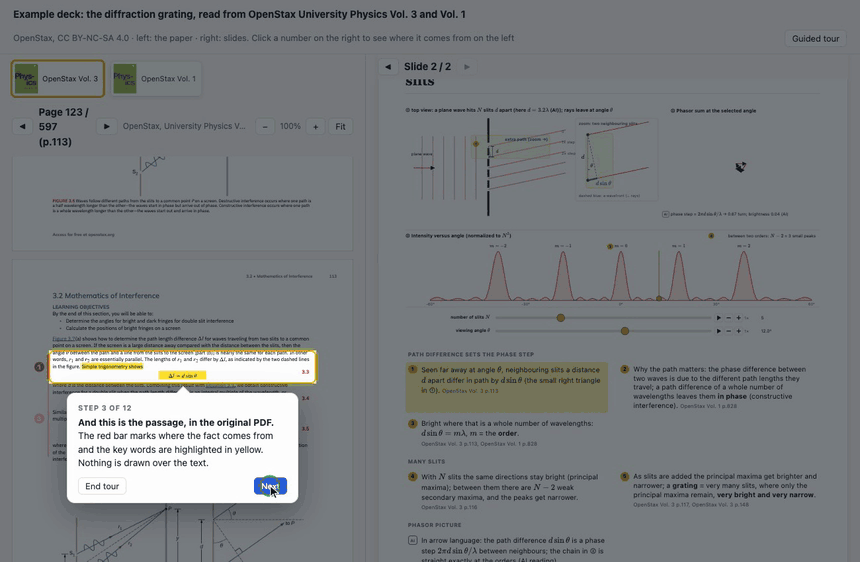
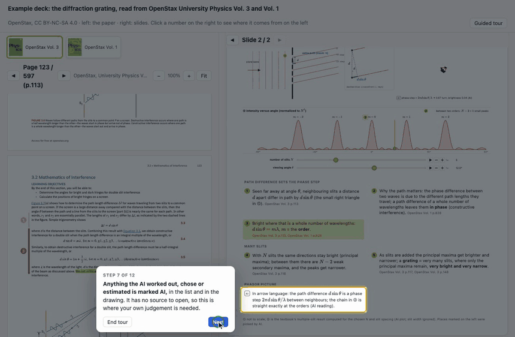

<picture>
  <source media="(prefers-color-scheme: dark)" srcset="media/brand/pawprint-logo-dark.svg">
  
</picture>

# Pawprint: source-linked reading slides

Read a paper with an AI, and keep every claim tied to the passage it comes from.

The original PDF stays on the left, complete. On the right the AI builds slides: an interactive drawing and a list of facts. Every fact taken from the paper opens the exact passage when clicked. Everything the AI worked out itself is marked **AI**.



## Click a fact, see where it comes from



## A fact with two sources opens both, each as the whole document



## Drawings are computed from the formulas



## Try it

1. Download this repository.
2. Give [`GUIDE.md`](GUIDE.md) to your AI assistant and ask it to set the tool up. It will download the two example textbooks from OpenStax, start a local web server and open the example page.
3. The example page offers a two-minute guided tour. The animations above are that tour.

To read a paper of your own, name the paper to your AI. `GUIDE.md` tells it how to make a deck.

The name: every fact leaves a pawprint that leads back to where it came from.

By hand, without an AI: follow section 3 of `GUIDE.md`.

## What is in the repository

```
GUIDE.md     how it works, how to set it up, how to make a deck, the rules
engine/      the engine, shared by every deck (plain JavaScript, no build step)
example/     a working deck: the diffraction grating, read from OpenStax University Physics
media/       the animations on this page; media/brand/ the logo and icons
```

## Credits and licence

The example quotes and shows pages of OpenStax, *University Physics* Volume 3 and Volume 1 (2016), licensed [CC BY-NC-SA 4.0](https://creativecommons.org/licenses/by-nc-sa/4.0/), free at [openstax.org](https://openstax.org). The PDFs are not included; each reader downloads them from OpenStax. The animations on this page show pages of those books under the same licence.

The engine bundles [PDF.js](https://mozilla.github.io/pdf.js/) (Apache 2.0) and [KaTeX](https://katex.org) (MIT).

No licence has been chosen yet for the engine and the guide; ask the author before reusing them elsewhere.

The animations are recorded in a headless Chrome by `engine/tools/record_workflow.py` (the workflow, the example's first slide) and `engine/tools/record_tour.py` (the guided tour).
